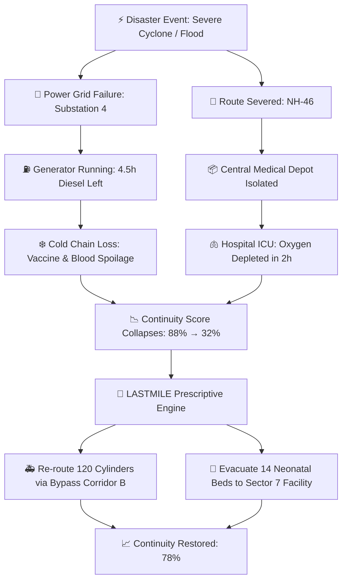

<div align="center">

# 🚑 LASTMILE
### *Essential Healthcare Continuity & Crisis Logistics Command Center*

[](https://nextjs.org/)
[](https://react.dev/)
[](https://www.typescriptlang.org/)
[](https://tailwindcss.com/)
[](https://fastapi.tiangolo.com/)
[](./LICENSE)

<br />

**When disasters strike, hospitals do not fail in isolation — they collapse in cascades.**  
LASTMILE models complex healthcare interdependencies (power, medical oxygen, staff, route networks) to simulate cascading breakdowns and compute optimal, life-saving resource reallocations in real time.

</div>

---

## 📌 Table of Contents

- [⚡ The Problem](#-the-problem)
- [💡 Our Solution](#-our-solution)
- [🎯 Key Features](#-key-features)
- [📐 Core Innovation: Healthcare Continuity Score (HCS)](#-core-innovation-healthcare-continuity-score-hcs)
- [🕹️ Disaster Simulation Scenario](#-disaster-simulation-scenario)
- [🏗️ System Architecture](#-system-architecture)
- [🛠️ Tech Stack](#️-tech-stack)
- [🚀 Quickstart](#-quickstart)
- [📂 Project Directory Structure](#-project-directory-structure)
- [🔒 Built-In Agent Protocols](#-built-in-agent-protocols)

---

## ⚡ The Problem

During major crises (cyclones, military conflicts, earthquakes, or epidemics), healthcare facilities face interconnected stress factors:
* ⚠️ **Supply Chain Bottlenecks:** Oxygen cylinders, blood units, and anti-trauma kits deplete rapidly.
* ⚡ **Lifeline Disconnections:** Municipal grid failures force facilities onto dwindling diesel generator reserves.
* 🚧 **Severed Transport Corridors:** Debris, flooding, or military blockades sever primary delivery routes.
* 👨‍⚕️ **Staff Burnout & Absenteeism:** Key surgical and ICU staff are isolated or overwhelmed.

Traditional disaster response relies on post-incident spreadsheets and static registries (e.g., WHO HeRAMS) that **track supplies after they are already depleted**, failing to anticipate how an outage at Substation A will shutter an ICU at Hospital B three hours later.

---

## 💡 Our Solution

LASTMILE goes beyond static inventory tracking:
1. **Dependency Graph Modeling:** Represents regional facilities, utility nodes, and routes as an interconnected directed network.
2. **Cascading Failure Simulator:** Simulates N-1 and N-2 disruption events and models time-to-exhaustion across critical lifelines.
3. **Deterministic Prescriptive Engine:** Employs constraint-satisfaction and minimum-cost network flow algorithms to prescribe exact, actionable resource transfers and patient diversions.



---

## 🎯 Key Features

| Feature | Description |
| :--- | :--- |
| **🌐 Dynamic Dependency Graph** | Real-time geospatial mapping of hospitals, depots, backup substations, and road arteries. |
| **⏱️ Lifeline Burn-Rate Monitor** | Live countdown clocks for medical oxygen, blood banks, ICU beds, and generator fuel. |
| **🧪 Cascading Failure Simulator** | Interactive toggles to trigger simulated power outages, blocked highways, and staff shortages. |
| **📊 Healthcare Continuity Score (HCS)** | A normalized mathematical index assessing regional clinical viability under distress. |
| **🧭 Prescriptive Mitigation Engine** | 1-click dispatch approvals proposing optimal transfer volumes, vehicle routes, and destination targets. |
| **🚨 SITREP Ingestion** | Rapid translation of unstructured emergency field reports into graph-actionable failure flags. |

---

## 📐 Core Innovation: Healthcare Continuity Score (HCS)

Rather than relying on vague heuristic estimations or black-box predictions, LASTMILE assesses regional resilience through a deterministic multi-factor formulation:

$$\text{HCS} = \sum_{s \in \mathcal{S}} \omega_s \cdot \min\left(1.0, \frac{\mathcal{C}_s}{\mathcal{D}_s}\right) \times \Phi_{\text{power}} \times \Phi_{\text{staff}} \times \Phi_{\text{cold-chain}}$$

* Where $\mathcal{S}$ represents critical service tiers (Trauma, Neonatal ICU, Dialysis, Emergency Surgery).
* $\mathcal{C}_s / \mathcal{D}_s$ measures current resource capacity vs. surge emergency demand.
* $\Phi$ factors denote operational lifeline multipliers $[0.0 \dots 1.0]$.

---

## 🕹️ Disaster Simulation Scenario

```
[ SCENARIO: Cyclone Vardah Impact on Central District ]
├─ 00:00: Baseline Healthcare Continuity Score: 91% (Normal Operations)
├─ 01:30: Substation 3 knocked offline → Hospital A on diesel reserves (6 hrs remain)
├─ 02:15: Arterial Highway 12 flooded → Depot cut off from Hospital A & B
├─ 02:45: Hospital A Oxygen burn rate spikes due to 28 incoming trauma cases
├─ 03:00: Critical Threshold Alert: Oxygen exhaustion predicted in 1 hr 45 min
│         Continuity Score plunges to 34% (CRITICAL FAILURE IMMINENT)
└─ LASTMILE INTERVENTION:
   ├─ Transfer 40 O2 cylinders from Community Center C (via elevated feeder road)
   ├─ Mutual-aid diversion: Reroute 12 incoming non-critical ambulances to Hospital D
   └─ Result: Healthcare Continuity Score recovers to 81%
```

---

## 🏗️ System Architecture

* **Frontend Client (Next.js 15+ App Router):** High-density war-room dashboards styled with Tailwind CSS v4 and accessible shadcn primitives.
* **Geospatial Map Canvas:** Interactive layer rendering health nodes, supply corridors, hazard polygons, and dynamic transport routes.
* **Optimization & Simulation Engine (Python / FastAPI):**
  * `NetworkX` for graph topology and shortest-path contingency rerouting.
  * `OR-Tools / SciPy` for constrained network flow resource reallocation.
* **Data Storage (PostgreSQL / TimescaleDB):** Spatio-temporal tracking of facility stock levels, burn velocities, and disaster logs.

---

## 🛠️ Tech Stack

* **UI & Client Framework:** Next.js, React 19, TypeScript
* **Styling & Components:** Tailwind CSS v4, shadcn/ui, Lucide Icons
* **Graph & Data Visualization:** Recharts, Leaflet / MapLibre, React Flow
* **Backend Services:** Python 3.12, FastAPI, Pydantic v2
* **Optimization Algorithms:** NetworkX, Google OR-Tools

---

## 🚀 Quickstart

### Prerequisites
- Node.js `20.x` or higher
- npm / pnpm / yarn
- Python `3.11+` (for optimization engine)

### 1. Clone Repository
```bash
git clone https://github.com/your-org/lastmile.git
cd lastmile
```

### 2. Frontend Installation
```bash
npm install
npm run dev
```
Open [http://localhost:3000](http://localhost:3000) to view the war-room interface.

### 3. Algorithmic Engine Setup (FastAPI)
```bash
cd backend
python -m venv venv
# Windows:
.\venv\Scripts\activate
# Linux/macOS:
source venv/bin/activate

pip install -r requirements.txt
uvicorn main:app --reload --port 8000
```

---

## 📂 Project Directory Structure

```plaintext
LastMile/
├── .agents/                    # 🤖 Protected AI agent skills & art direction
│   └── skills/
│       ├── design-taste-frontend/  # Anti-slop UX & typography guidelines
│       ├── shadcn/                 # Component composition patterns
│       └── web-design-guidelines/  # Accessibility and design standards
├── app/                        # ⚡ Next.js App Router
│   ├── layout.tsx              # Root app wrapper & providers
│   ├── page.tsx                # Disaster Command Dashboard
│   └── simulation/             # Interactive scenario sandbox
├── components/
│   ├── modules/                # 🧩 Core domain modules
│   │   ├── map/                # Geospatial network canvas
│   │   ├── metrics/            # Lifeline burn-rate gauges & HCS meters
│   │   ├── simulator/          # Crisis failure toggle switches
│   │   └── actions/            # Reallocation & transfer approval drawer
│   └── ui/                     # 🎨 shadcn component library
├── lib/                        # 🧮 Math formulas, API clients & graph utils
├── types/                      # 📐 TypeScript interfaces & disaster schemas
├── AGENTS.md                   # 🔒 Agent instructions & immutability rules
├── skills-lock.json            # 🔐 Skill dependency integrity lock
└── package.json
```

---

## 🔒 Built-In Agent Protocols

To maintain exceptional UI quality and architectural stability, all human contributors and AI agents abide by the guidelines in [`AGENTS.md`](./AGENTS.md):
* **`.agents/skills/` is Read-Only:** Preserved across iterations to guarantee anti-slop design taste, accessibility standards, and component consistency.
* **Deterministic Optimization:** Clinical capacity calculations must rely on transparent mathematical formulations, not hallucinated estimations.
* **Zero Cognitive Clutter:** Mission-critical emergency screens adhere strictly to high-contrast, high-legibility guidelines.

---

<div align="center">
  <sub>Built with purpose for resilient public health systems during extreme emergencies.</sub>
</div>
